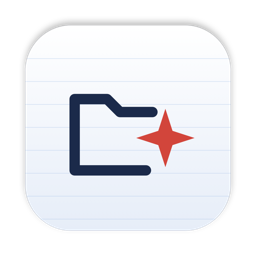

<p align="center">
  
</p>

<h1 align="center">Voxi</h1>

<p align="center">
  Organize your Mac's files by saying what you want.<br />
  <a href="https://github.com/ruck-syu/Voxi/releases/latest"><b>Download for Mac</b></a>
</p>

---

Press <kbd>⌃⌥Space</kbd> anywhere. A small window opens with the cursor ready.
Type a command, or dictate it with [Wispr Flow](https://wisprflow.ai):

> move all PDFs from Downloads to Documents

Voxi shows exactly what will happen, file by file. Press <kbd>Enter</kbd> to
run it, or <kbd>Esc</kbd> to back out. Changed your mind afterwards?
Say **undo last**.

## What it can do

| You say | Voxi |
|---|---|
| move screenshots from today to Screenshots | Files today's screenshots, wherever they are |
| clean up Downloads older than 90 days | Moves old files to the Trash |
| rename report.pdf to Q3-report.pdf | Renames one file |
| replace spaces with dashes in files in Downloads | Renames in bulk |
| sort Downloads by type | Groups files into Images, PDFs, Videos, and more |
| convert all HEIC in Pictures to jpg | Writes JPG copies |
| merge PDFs in Documents named scan into scan-all.pdf | Combines PDFs |
| zip Project into Project.zip | Compresses a folder |
| list files in Downloads larger than 500 MB | Shows matches, changes nothing |
| run my usuals | Runs a shortcut you saved in Settings |

There are 27 kinds of commands, with filters for type, date, size, and name.
The full list is on the [Commands page](website/commands.html).

## Safe by design

- **Nothing changes until you press Enter.** Every command is previewed first.
- **Nothing is erased.** "Delete" and "clean up" move files to the Trash.
- **Nothing is overwritten.** A clashing name becomes `report 2.pdf`, and the preview says so.
- **Everything can be undone.** "Undo last" reverses the newest change as one step, after its own preview.
- **Voxi stays in its lane.** It only touches Desktop, Downloads, Documents, Pictures, and folders you add in Settings.
- **No guessing.** When a name matches several files, Voxi lists them and asks which one; say a number to answer.

## Install

1. Download the `.dmg` from the [latest release](https://github.com/ruck-syu/Voxi/releases/latest), open it, and drag Voxi to Applications.
2. Open Voxi. It isn't notarized by Apple yet, so the first launch is blocked:
   - **macOS 15 or later:** open System Settings → Privacy & Security, scroll down, and click **Open Anyway** next to Voxi.
   - **macOS 14 or earlier:** right-click Voxi in Applications, choose **Open**, then **Open** again.

   macOS remembers this, so you only do it once.
3. Voxi opens a welcome page. Click **Allow access** and approve each folder, so commands never stop to ask.

Voxi lives in the menu bar. Click its icon or press <kbd>⌃⌥Space</kbd>.

## Updates

Open Settings → General → **Check for updates**. Voxi downloads the newest
release with a progress bar, shows what's new, checks the update's signature,
installs it, and restarts.

## Shortcuts

Save a phrase and a list of commands in Settings → Shortcuts. Saying the
phrase runs them all as one preview with one undo. "Run my usual" and
"run my usuals" both work.

## Develop

Voxi is a [Tauri](https://tauri.app) app: Rust for parsing and file work, React
for the window.

```bash
cd app && npm install
```

```bash
cd app && npm run tauri dev
```

Tests cover one sentence per catalog row, safety rules, undo, and real runs of
`sips`, `ditto`, and PDFKit in a temporary folder:

```bash
cd app/src-tauri && cargo test --lib
```

`npm run dev` alone serves the window in a browser with a stand-in backend
(`app/src/mock.ts`), useful for design work.

### Project layout

| Path | What's there |
|---|---|
| `app/src-tauri/src/parse/` | Rule-based parser, one file per kind of command |
| `app/src-tauri/src/plan.rs` | Resolves names, expands filters, checks paths, builds the preview |
| `app/src-tauri/src/exec.rs` | Runs a confirmed plan and records how to undo each step |
| `app/src/` | The floating window: commands, settings, folder access |
| `website/` | The landing page, deployed to Vercel |
| `docs/icon/` | The app icon and the script that draws it |
| `BUILD.md` | The original build plan |

### Releases

Every push to `main` that touches the app runs
[`.github/workflows/release.yml`](.github/workflows/release.yml). It runs the
tests, builds a universal app for Apple silicon and Intel, signs it, and
publishes a release with:

- the `.dmg` for new installs,
- a signed update bundle and `latest.json` for in-app updates,
- release notes listing every change since the previous version.

The workflow needs four repository secrets: `TAURI_SIGNING_PRIVATE_KEY` and
`TAURI_SIGNING_PRIVATE_KEY_PASSWORD` sign updates; `VOXI_SIGNING_CERT` and
`VOXI_SIGNING_CERT_PASSWORD` give the app a stable code signature, so macOS
remembers folder access across versions.

### Website

`website/` is a static site with no build step. In Vercel, import this repo and
set **Root Directory** to `website`. Pushes that only touch the website or docs
don't build a new app.

---

Built for No Hands: The Wispr Challenge by [WeMakeDevs](https://www.wemakedevs.org).
