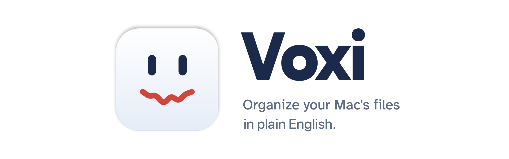

<p align="center">
  <picture>
    <source media="(prefers-color-scheme: dark)" srcset="docs/readme/banner-dark.png" />
    
  </picture>
</p>

<p align="center">
  <a href="https://github.com/ruck-syu/Voxi/releases/latest"><b>Download for Mac</b></a>
  &nbsp;&nbsp;|&nbsp;&nbsp;
  <a href="https://tryvoxi.vercel.app">Website</a>
  &nbsp;&nbsp;|&nbsp;&nbsp;
  <a href="https://tryvoxi.vercel.app/commands">Commands</a>
  &nbsp;&nbsp;|&nbsp;&nbsp;
  <a href="#install">Install</a>
  <br />
  <sub>Free and open source. macOS 12 or later, Apple silicon and Intel.</sub>
</p>

---

Press <kbd>⌃⌥Space</kbd> anywhere. A small window opens with the cursor ready.
Type a command or dictate with an app such as [Wispr Flow](https://wisprflow.ai) or [Hex by Anomaly](https://anoma.ly/hex/):

> move all PDFs from Downloads to Documents

Voxi shows exactly what will happen, file by file. Press <kbd>Enter</kbd> to
run it, or <kbd>Esc</kbd> to back out. Changed your mind afterwards?
Say **undo last**.

## What it can do

| You say | Voxi |
|---|---|
| move screenshots from today to Screenshots | Files today's screenshots, wherever they are |
| clean up Downloads older than 90 days | Moves old files to the Trash |
| rename report.pdf to Q3-report.pdf | Renames one file |
| create a folder in Downloads named PDFS | Creates the PDFS folder in Downloads |
| replace spaces with dashes in files in Downloads | Renames in bulk |
| sort Downloads by type | Groups files into Images, PDFs, Videos, and more |
| convert all HEIC in Pictures to jpg | Writes JPG copies |
| merge PDFs in Documents named scan into scan-all.pdf | Combines PDFs |
| zip Project into Project.zip | Compresses a folder |
| list files in Downloads larger than 500 MB | Shows numbered matches, changes nothing |
| delete 4 | Trashes row 4 of the list on screen |
| move PDFs from Downloads to Documents at 9 pm | Runs once, tonight |
| delete dmg files from Downloads every 3 days | Repeats on a schedule |
| run my usuals | Runs a shortcut you saved in Settings |

There are 27 kinds of commands, with filters for type, date (including months,
like "in August"), size, and name. See the [Commands page](https://tryvoxi.vercel.app/commands)
for the full catalog and [docs/COMMANDS.md](docs/COMMANDS.md) for search,
quoting, list, chaining, scheduling, and shortcut details.

## Install

With [Homebrew](https://brew.sh), run this, then continue from step 2:

```bash
brew install --cask ruck-syu/tap/voxi
```

Or by hand:

1. Download the `.dmg` from the [latest release](https://github.com/ruck-syu/Voxi/releases/latest), open it, and drag Voxi to Applications.
2. Open Voxi. Releases are signed with Voxi's own certificate but are not notarized by Apple yet, so macOS blocks the first launch:
   - **macOS 15 or later:** open System Settings → Privacy & Security, scroll down, and click **Open Anyway** next to Voxi.
   - **macOS 14 or earlier:** right-click Voxi in Applications, choose **Open**, then **Open** again.

   macOS remembers this, so you only do it once.
3. On the welcome page, click **Allow access** and approve Desktop, Downloads, Documents, and Pictures. These standard **Files and Folders** grants are all Voxi needs by default; it does not need Full Disk Access unless you ask it to work in a protected location outside those folders (see [docs/SAFETY.md](docs/SAFETY.md#permissions)).

Voxi lives in the menu bar as a small face. Click it or press <kbd>⌃⌥Space</kbd>
to open or close it. To update later, open Settings → General → **Check for
updates** — Voxi downloads the release, verifies its signature, installs it, and
restarts.

## Everyday workflows

- **Search and lists:** Commands search the folder you name and its subfolders
  (skipping hidden, system, and build folders like `node_modules`). Moves,
  copies, and deletes stay directly inside the named folder unless you add
  `including subfolders`. After a `list` command, follow-up commands act on that
  exact list (`delete 4`, `move PDFs to Documents`).
- **Chaining:** Join up to eight folder-creation, move, copy, rename, or trash
  steps with `and`, `then`, `and then`, or `;` — for example,
  `create a folder in Downloads called PDFS and move PDFs into it` — for one
  preview and one undo.
- **Schedules:** Add a time, delay, or repeat to the end of a command (`at 9:40 pm`,
  `after 3 hours`, `every Monday at 8 am`) and manage tasks in Settings →
  Scheduled. Tasks run while Voxi is running; overdue tasks run once when Voxi
  next runs or your Mac wakes.
- **Shortcuts:** Save a phrase and a list of commands in Settings → Shortcuts to
  run them all as one preview with one undo.
- **From Finder:** Select files in Finder, right-click, and choose **Organize
  with Voxi** (under Quick Actions or Services) to act on `"these"` or
  `"them"`. In **Open With**, choose **Other… → All Applications** and select Voxi.
  If the Service is missing, enable it in System Settings → Keyboard → Keyboard
  Shortcuts → Services (on macOS 12, System Preferences → Keyboard → Shortcuts →
  Services).
- **Dictation:** Focus the command bar and dictate with any external dictation
  app such as [Wispr Flow](https://wisprflow.ai) or
  [Hex by Anomaly](https://anoma.ly/hex/), then press <kbd>Enter</kbd> to
  review. Voxi has no built-in recording or speech recognition and never
  requests microphone or speech permissions.
- **Local learning:** Voxi's parser is rule-based and runs locally. You can
  teach it rephrased commands (saved in Settings → Shortcuts), save folder
  nicknames when a name matches several folders, and optionally record local
  wrong-result reports (no filenames) in Settings.

Full rules and edge cases are documented in [docs/COMMANDS.md](docs/COMMANDS.md).

## Safe and private by design

- **Nothing changes until you press Enter.** Every command is previewed first.
- **Nothing is erased.** "Delete" and "clean up" move files to the Trash.
- **Nothing is overwritten.** Clashing names become `report 2.pdf` in the preview, and destinations are claimed atomically.
- **Everything can be undone.** `undo last` reverses the newest change as one step, after its own preview.
- **Voxi stays in its lane.** It only touches Desktop, Downloads, Documents, Pictures, and folders you add in Settings.
- **No guessing.** When a name matches several files, Voxi lists them and asks which one; say a number to answer.

Voxi runs 100% locally with no telemetry and uploads nothing. Small local error
logs record only error codes and counts — never command text, folder names,
filenames, or paths. See [docs/SAFETY.md](docs/SAFETY.md) for crash recovery,
symlink rules, and limits, and [docs/PRIVACY.md](docs/PRIVACY.md) for
diagnostics and local feedback details.

## Develop

Voxi is a [Tauri](https://tauri.app) app: Rust for parsing and file work, React
for the window.

```bash
cd app && npm install
cd app && npm run tauri dev
```

Development builds run as `"Voxi Dev"` (`dev.voxi.app.dev`) with separate
settings, history, schedules, and login item so they never touch an installed
Voxi on the same Mac. Give the dev build a different hotkey if both run at once.

```bash
cd app/src-tauri && cargo test --lib   # Rust parser, planner, safety, undo, and macOS tool tests
cd app && npm run dev                  # UI in a browser with a mock backend (app/src/mock.ts)
```

### Project layout

| Path | What's there |
|---|---|
| `app/src-tauri/src/parse/` | Rule-based parser, one file per kind of command |
| `app/src-tauri/src/plan.rs` | Resolves names, expands filters, checks paths, builds the preview |
| `app/src-tauri/src/exec.rs` | Runs a confirmed plan and records how to undo each step |
| `app/src/` | The floating window: commands, settings, folder access |
| `website/` | The landing page, deployed to Vercel |
| `docs/` | Command, safety, privacy, developer, and release docs; banner & icon assets |

### Releases and versioning

Pushes to `main` automatically publish a release whenever `app/` or `crates/` changed since the latest `vX.Y.Z` tag. The next version is derived from the PR titles (or direct commit subjects) merged since that tag:

- **Patch (default):** normal PR titles and commits (`0.0.3` → `0.0.4`)
- **Minor:** prefix the PR title with `feat:` or `feat(scope):` (`0.0.3` → `0.1.0`)
- **Breaking:** prefix with `<type>!:` (e.g. `feat!:`) or add a `BREAKING CHANGE:` line. Before 1.0 this bumps the minor version (`0.1.4` → `0.2.0`); from 1.0 on it bumps major. To cut 1.0.0, run the workflow manually with `major`.
- **Skip a release:** include `[skip release]` in the PR title (or commit message)
- **Manual release / override:** run the **Release** workflow manually (`workflow_dispatch`) and pick `auto`, `patch`, `minor`, or `major`

For CI checks, release notes, and macOS signing/notarization, see
[docs/RELEASING.md](docs/RELEASING.md).
For the parser corpus, held-out evaluations, opt-in experimental local model
(`dev:model`), and website setup, see [docs/DEVELOPING.md](docs/DEVELOPING.md).
